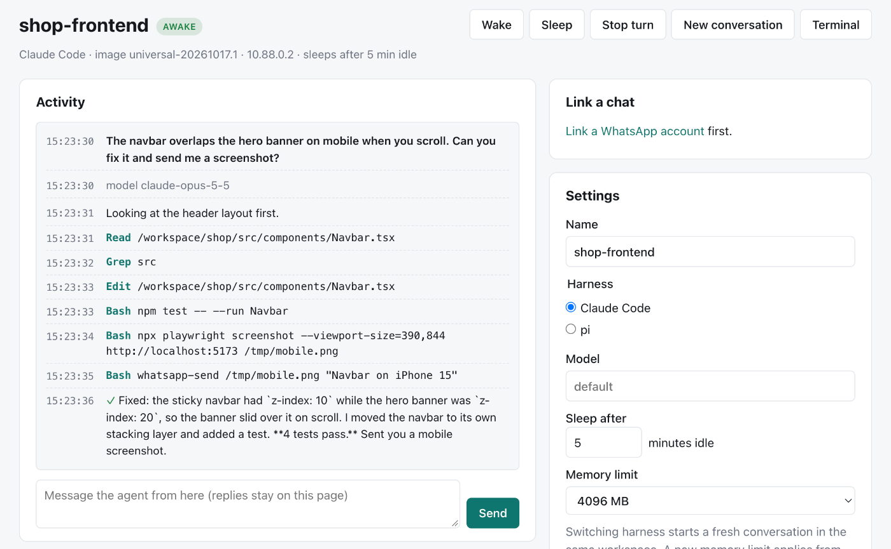
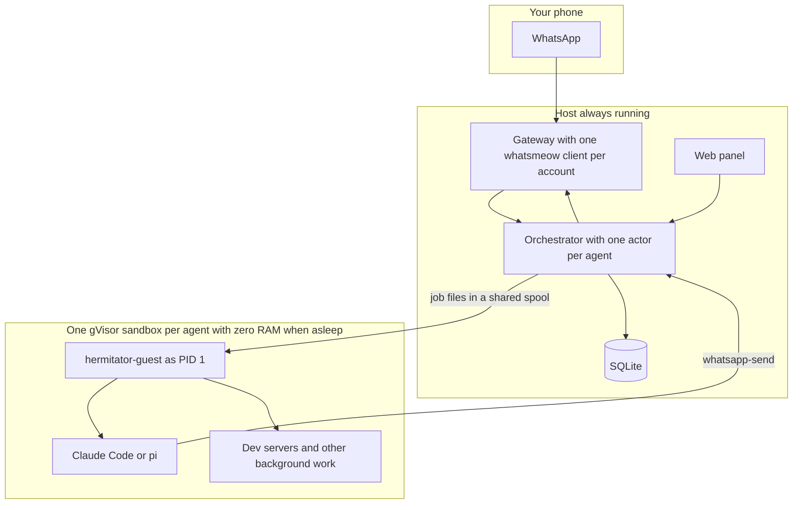

# hermitator

Coding agents that live in their own sandboxed Linux machines, wake up when
you message them on WhatsApp, and use no memory while they sleep.

Your agents get their own WhatsApp number. You send it *"the navbar overlaps
the hero on mobile, fix it and send me a screenshot"*, and hermitator wakes the
agent bound to that chat, a
[gVisor](https://gvisor.dev) sandbox with its own filesystem, network and
toolchain, within about a tenth of a second, and hands your message to
[Claude Code](https://docs.claude.com/en/docs/claude-code) or
[pi](https://github.com/earendil-works/pi) running inside it. When the agent
is done, the reply and the screenshot arrive in the chat. A few idle minutes
later the sandbox is gone from memory: stopped if nothing was running, or
checkpointed to disk, dev server and all, ready to resume exactly where it
left off.

Because only the agents you are talking to use RAM, one modest server can
keep hundreds of them.



## What you get

- **A machine per agent.** Each agent runs in gVisor, a kernel in user space
  that intercepts every system call. It gets its own root filesystem
  (OverlayFS over a shared, read-only image) and its own network namespace,
  which reaches the internet but not the host, other agents or private
  networks. It is root inside, so `apt`, `npm`, `pip` and `uv` just work, and
  everything it installs persists.
- **No RAM while idle.** An idle agent with nothing running is stopped. One
  with background processes (a dev server, a database) is checkpointed, and
  those processes carry on when the next message arrives.
- **Your own subscriptions.** Claude Code runs with a token from
  `claude setup-token`. pi runs with a ChatGPT subscription (through OpenAI's
  device-code login, done from the panel), a DeepSeek key or an OpenRouter
  key.
- **WhatsApp as the interface.** hermitator links to a WhatsApp number the
  way WhatsApp Web does: ideally one that belongs to your agents, so you
  message them like a contact, though it can share your own too. Each chat
  with that number (or each group it is in) is bound to an agent with
  `/link CODE`. An agent can be in several chats, each with a
  conversation of its own; they share its files. Photos, voice notes (transcribed locally with whisper.cpp, with a word list per
  agent for names and jargon)
  and documents go in; replying to a photo or file sends it along again.
  Files come back when the agent runs `whatsapp-send`.
  Read receipts and a ⏳ reaction say it is working, ✅ says it is done,
  and 📥 says a message is waiting for the turn in progress. A turn that
  runs past a minute gets one progress line in the chat, edited in place
  as the work moves on (edits make no sound), and finished with how long
  it took.
  When an agent needs you to choose ("Deploy to production?"), it can
  send a WhatsApp poll; your tap comes back to it as a message.
- **Work that carries on without you.** Ask an agent to do something
  later ("every weekday at 9, check CI and tell me") and it schedules it;
  the host keeps the timetable, so the agent still sleeps until then. A
  task can start with a shell check ("every 10 minutes, if the build is
  red, look into it") that wakes the model only when it finds something,
  and a run with nothing to report sends nothing.
  A long job the agent starts with `hermitator-guest notify` (a test
  suite, a build) wakes it when it ends, so it can tell you how it went;
  other background jobs report with `whatsapp-send --text`. `/sh` runs a
  quick command without the model. Optional
  daily and monthly spending limits stop anything running away.
- **Agents that start from a repository.** Give a new agent `owner/repo`
  or an https URL and it starts with the repository cloned into its
  workspace (private GitHub ones with your token), and, if you like, sets
  it up: installs dependencies, runs the tests, notes how to run it, and
  reports back.
- **Cheap to wake after days.** A long conversation is compacted just
  before the agent sleeps, while its history is still cached, so the next
  wake re-reads a summary instead of paying full price for all of it.
  Nothing is lost: `hermitator-guest recall` lets the agent search the
  chat's past conversations, and its history if you keep one, without a
  model call. Every ten turns or so, before sleeping, it also writes down
  lasting facts (how your projects are set up, what you prefer) in the
  memory file it reads at the start of every conversation.
- **Preview links.** With a preview domain set up, an agent running a dev
  server sends you a link (`/preview 3000`, or the agent asks for one) that
  opens it on your phone, waking the agent if it was asleep.
- **A control panel.** Live activity per agent, a console for talking to it
  from the browser, a terminal inside the sandbox, users with an admin who can
  act as them, and an audit log.
- **One binary and SQLite.** No queue, no Redis, no Docker daemon.

## Numbers

Measured on a Hetzner dedicated server (Ryzen 5 3600, 64 GB RAM, NVMe) with
gVisor release 20261012.0 on the systrap platform:

| | |
|---|---|
| Wake a stopped agent (cold boot) | 70–100 ms |
| Wake a checkpointed agent | 55–60 ms |
| Checkpoint of an agent running a Python web server | 13 MB on disk |
| An awake, idle agent | 28 MB of RAM (39 MB with that web server) |
| A sleeping agent | 0 |
| hermitator itself | about 60 MB |

The model's own thinking time is, of course, extra.

## How it works



A few decisions shape everything else:

- **WhatsApp lives on the host.** Its multi-device protocol needs a
  connection that never sleeps, so one Go process holds a
  [whatsmeow](https://github.com/tulir/whatsmeow) client for every linked
  account and only wakes a sandbox when a message is routed to it.
- **Nothing runs through `runsc exec`.** gVisor kills every process started
  by `exec` when it restores a checkpoint. So the guest binary is PID 1 and
  runs jobs that the host drops into a shared spool directory as plain
  files. Every process an agent starts is a descendant of PID 1, and survives
  sleep.
- **Sleep picks the cheaper option.** If PID 1 is the only process left, the
  sandbox is stopped: all state is already on disk in its upper layer. If
  anything else is running, it is checkpointed.
- **The sandbox is untrusted, including what it writes.** Every file the
  host reads or writes under a sandbox's shared directories goes through
  Go's `os.Root`, so an agent cannot plant a symlink that makes the host
  read or write elsewhere.

[docs/architecture.md](docs/architecture.md) covers the rest: the turn
protocol, the network policy, credentials and what happens on restart.

## Install

You need a Linux server (x86-64 or arm64) where you have root, with systemd.
No nested virtualization is required. hermitator is developed on Arch Linux;
the install script also knows apt. For HTTPS, point a domain at the server
and hermitator puts [Caddy](https://caddyserver.com) in front of it.

From a machine with Go 1.27:

```sh
git clone https://github.com/rahimnathwani/hermitator
cd hermitator
deploy/deploy.sh root@your-server hermitator.example.com
```

That builds both binaries, copies them over SSH and runs
[deploy/install.sh](deploy/install.sh), which installs a pinned gVisor
release (checksum verified), writes `/etc/hermitator/hermitator.env` with a
new master key, configures Caddy, builds the agent image (about 2.5 GB; the
first build takes a few minutes) and starts the service. Run it again to
upgrade. Running sandboxes keep running across upgrades.

hermitator's Caddy site is its own file, `/etc/caddy/conf.d/hermitator.caddy`,
which the main Caddyfile imports along with anything else in that directory.
To serve another app from the same server, give it a file of its own there,
such as `/etc/caddy/conf.d/myapp.caddy`, and `systemctl reload caddy`;
reinstalling hermitator leaves it alone.

The image pins exact versions of Claude Code, pi and Playwright, and
their auto-updaters are off, so a new release changes nothing until you
choose it. To move to the newest, run `make image-bump` (it rewrites the
pins in `image/Containerfile`; review and commit the diff), then
`make image`, which deploys and builds the image on the server. New agents
get it; existing ones offer an upgrade, one at a time on their Settings tab
or all at once from the agents page, and keep all their files. To also
build whisper.cpp for voice notes, prefix the build with `WITH_WHISPER=1`.

Agents are told not to update Claude Code or pi themselves: a copy they
install lands in their own layer and hides every later image version. If
one does anyway, its Settings tab says so and can remove the copy.

Claude Code plugins, pi extensions, skills and MCP servers need no image
change. They live in each agent's home directory and survive sleep and
image upgrades: install them from the agent's Terminal tab
(`claude plugin install …`, `pi install …`), or ask the agent to. They
take effect from the next message.

Or, without Go, on the server itself: download a release from
[GitHub](https://github.com/rahimnathwani/hermitator/releases), unpack it and
run `sudo HERMITATOR_DOMAIN=hermitator.example.com deploy/install.sh` from
inside it.

Then, on the server:

```sh
hermitator doctor                              # check the host
hermitator user add admin@example.com --admin  # prints a password
hermitator user add you@example.com            # prints a password
```

Admins manage users but do not own agents themselves, so you will usually
want both. Then log in as yourself and:

1. **Settings:** paste the token from running `claude setup-token` on your own
   computer, and/or connect ChatGPT or add API keys for pi.
2. **WhatsApp:** link the agents' number by scanning the QR code with the
   phone that has it, or by typing a code into that phone.
3. **Agents:** create one.
4. From your own WhatsApp, send the agent's `/link` code to the agents'
   number. That chat now talks to the agent, and hermitator now knows your
   number. For more agents on the same number, make a group with the
   number per agent and `/link` each one.

For preview links, point a wildcard DNS record (`*.preview.example.com`)
at the server and set `DEPLOY_PREVIEW_DOMAIN=preview.example.com` (or run
install.sh with `HERMITATOR_PREVIEW_DOMAIN`). Caddy gets a certificate for
each preview hostname the first time it is visited, after asking hermitator
whether it has a link.

WhatsApp unlinks companion devices whose phone has been offline for about
two weeks, so open WhatsApp on the agents' phone now and then.

## Using it

Everything you send in a linked chat goes to its agent, except these, which
hermitator answers itself:

| Command | |
|---|---|
| `/status` | What the agent is doing, its state and disk use |
| `/sleep` | Suspend it now (alias `/exit`) |
| `/stop` | Abort the current turn |
| `/retry` | Run the last message again, after a failure or a restart |
| `/sh COMMAND` | Run a shell command in the sandbox and get its output, without the model |
| `/tasks`, `/tasks pause N`, `/tasks resume N`, `/tasks delete N` | Scheduled tasks |
| `/plan` | The agent's own task list for what it is doing, without waking it |
| `/usage` | Claude subscription use (5-hour and weekly, with pace) and spending |
| `/sessions`, `/resume N` | Past conversations, and going back to one (`/new` keeps them) |
| `/fork` | Branch the next message off this conversation (Claude Code) |
| `/history on`, `/history off` | Keep this chat's messages, everyone's, in a file the agent can search |
| `/preview PORT`, `/previews`, `/previews off` | A link to a web server the agent runs; list them; turn them all off |
| `/timezone Europe/London` | The time zone schedules use (also in Settings) |
| `/new` | Start a fresh conversation in this chat; files are kept (alias `/clear`) |
| `/compact` | Summarise this conversation now, so the next messages re-read less |
| `/model`, `/model opus`, `/model default` | Show or change the model |
| `/effort`, `/effort high`, `/effort default` | Show or change how hard it thinks |
| `/once opus max: …` | Use another model or effort for this one message |
| `/switch claude` or `/switch pi` | Change harness, same workspace |
| `/listen` | Show or change which messages wake the agent in this chat |
| `/link CODE`, `/unlink` | Bind this chat to an agent, or unbind it |
| `/help` | The list |

Model and effort changes apply from the next message, and the conversation
carries on. Claude Code takes `fable`, `opus`, `sonnet`, `haiku` or a full
model ID, with effort from `low` to `max`; pi takes its provider's models,
with thinking from `off` to `max`. The agent's Settings tab has the same
choices, and its Overview shows which model each turn actually ran on.

A message that is only a slash word hermitator does not know, or that
opens with one of Claude Code's or pi's own commands (`/cost`, `/mcp`),
gets an explanation instead of a turn: the harness would have read it as
plain text. Only you can use commands: messages from your own numbers
(listed in Settings, and learnt from `/link`), or sent by the linked
account itself when it is your own number.

Each linked chat has two settings: which of **your** messages wake the agent,
and which of **other people's** do. Each is *always*, *by mentioning it* or
*never*. Mentioning means an @mention of the agent's number, a reply to one
of its messages, or typing `@` and the agent's name. When you `/link` a
direct chat, or a group with just you and the agent's number, your messages
always wake it and other people's never do. In a group with other people,
you wake it by mentioning it. Change this on the agent's Chats tab or with
`/listen` (for example `/listen others all`).

A message that does not wake the agent wakes nothing at all: no sandbox, no
model call. hermitator keeps it, up to the last 200 per chat, and hands it
to the agent as context with the next message that does. So in a group with
a friend you can talk among yourselves and then ask *"@shop-frontend, can
you do what Sam suggested?"*. Commands from you always work, and never wake
the agent either.

Messages sent in quick succession, a photo and then its caption say, become
one turn. A message you send while a Claude Code agent is working ("actually,
make it blue") reaches it in the middle of what it is doing, and gets 👀;
with pi, it waits for the next turn, and gets 📥.

Each turn's cost appears under Recent turns on the agent's Overview. It is what the model would
have charged at API prices: on a Claude or ChatGPT subscription you are not
billed per token, but it is a fair measure of how much of your allowance a
turn used.

Anyone who is not in a chat you linked is ignored, so strangers who find the
agent's number get nothing. An account can also have a **fallback agent**,
which answers your direct messages to the number without a `/link`. It
listens only to your numbers, never to strangers or groups.

## Configuration

The service reads `HERMITATOR_*` variables from
`/etc/hermitator/hermitator.env`. The only required one is the master key; the
rest have sensible defaults. They are all listed in
[.env.example](.env.example).

## Security model

What the sandbox protects is the host, and other agents, from an agent:

- gVisor implements Linux in user space, so the agent never talks to the
  host kernel directly.
- The agent sees its own filesystem, plus `/shared` (media in and out), the
  job spool and hermitator's tools (read-only). The host treats all of them
  as hostile input.
- Network traffic from the sandbox can reach the internet and nothing else:
  not the host, not other agents, not private or link-local ranges.
- Credentials are encrypted at rest (XChaCha20-Poly1305 under the master key),
  passed to the harness only for the turns that need them, never on a command
  line, and removed from the sandbox before it is suspended.

What it does not protect:

- **The agent holds your credentials while it works.** It needs them to call
  the model, and it gets your GitHub token and your own secrets (set in
  Settings, never typed into WhatsApp) as environment variables during its
  turns. Background processes it starts inherit them. hermitator removes
  their values from everything the agent sends you and from what it stores,
  but not from files it sends. Treat an agent like a laptop logged into
  your accounts, or turn on **Keep them out of the sandbox** (beta) in
  Settings: agents then hold placeholders, and a proxy on the host swaps
  in the real values only on the way to each credential's own service.
- **A preview link is a key.** Anyone with one can see that port until you
  turn the agent's links off (`/previews off`, or its Settings tab), and
  opening it wakes the agent. Preview hostnames appear in public
  certificate logs, so the secret is in the link, not the name. Pages are
  served from their own subdomain, and the panel's cookies are `__Host-`
  cookies, which a preview cannot set.
- **Whatever reaches the agent reaches your model provider.** Other
  people's messages in a linked chat are passed on as context even when they
  do not wake the agent. If you let them wake it, they can drive it, and it
  can be talked into revealing what it holds. Strangers messaging the agents'
  number are ignored.
- **WhatsApp does not officially support this.** whatsmeow speaks the same
  protocol as WhatsApp Web, but WhatsApp can and does ban numbers it decides
  are automated. A number of its own for the agents keeps your personal one
  out of it.
- **hermitator runs as root on the host.** It has to, to mount filesystems
  and manage network namespaces.
- **Subscriptions have terms.** hermitator drives the official CLIs with your
  tokens. Check that your plan allows what you do with it.

## Development

The real runtime needs Linux and root, but everything else runs on a Mac:

```sh
make dev     # the panel on http://127.0.0.1:8080, agents run unsandboxed
make test    # including end-to-end turns through the real guest binary
make lint
```

`make dev` uses `HERMITATOR_RUNTIME=unsafe-local`, which runs agents as
ordinary processes on your machine. It is for working on hermitator, not for
running agents you do not trust.

| | |
|---|---|
| [cmd/hermitator](cmd/hermitator) | The service and its admin commands |
| [cmd/hermitator-guest](cmd/hermitator-guest) | PID 1 inside every sandbox, the turn runner and `whatsapp-send` |
| [internal/orchestrator](internal/orchestrator) | Routing, turns, sleep and wake |
| [internal/sandbox](internal/sandbox) | runsc, OverlayFS, network namespaces and nftables |
| [internal/spool](internal/spool) | Running processes in a sandbox through files |
| [internal/harness](internal/harness) | Driving Claude Code and pi headlessly |
| [internal/gateway](internal/gateway) | WhatsApp |
| [internal/web](internal/web) | The panel |
| [image](image) | The agent image |
| [deploy](deploy) | Installation |

## Limitations

- A checkpoint only restores on the same CPU architecture and gVisor
  version. After a gVisor upgrade, a checkpointed agent boots cold instead:
  its files are all there, but whatever was running is not.
- Processes started from the web terminal do not survive a checkpoint
  (gVisor drops `exec` sessions on restore). Ask the agent to start
  long-running things instead.
- No per-agent disk quotas or egress allowlists yet.
- One host. There is no clustering, and no plan for it.

Ideas not yet built are in [docs/ideas.md](docs/ideas.md).

## License

[MIT](LICENSE)
