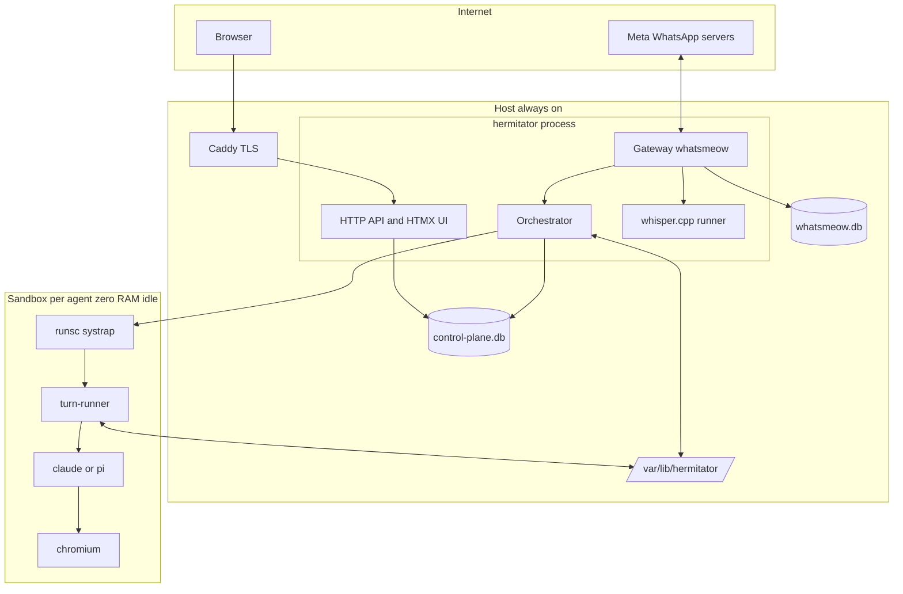

# Hermitator design

Status: accepted. Items marked **verify** were assumptions confirmed or corrected during the spike.

## 1. Purpose

Self-hosted, multi-tenant hosting for coding agents (Claude Code and pi). Each agent lives in its own gVisor sandbox on one Linux host, is woken by WhatsApp messages, and costs zero RAM while idle. Only the WhatsApp gateway, control plane, web UI, and orchestrator stay resident, all inside one Go process.

## 2. Decisions summary

| Area | Decision |
|---|---|
| Stack | Single Go binary: whatsmeow gateway, HTTP API, HTMX web UI, orchestrator. Module `github.com/rahimnathwani/hermitator`. Go 1.27. |
| Web UI | Server-rendered `html/template` + HTMX. SSE for QR stream and turn log. xterm.js web terminal in v1. |
| Harnesses | Claude Code and pi both in milestone 2, via a `turn-runner` shim. Claude driver is the `claude -p` CLI with stream-json. pi driver is `pi --mode rpc`. |
| Tenancy | Multi-tenant from day one: users, email + password login, RBAC, admin impersonation, audit log. First admin via CLI subcommand. |
| Idle policy | Hybrid: kill if only PID 1 remains, checkpoint if background processes exist. Default idle 300 s. |
| Network | Per-agent netns on host bridge `br-agents` 10.88.0.0/16, nftables blocks agent↔agent and agent→host private ranges, NAT out. `runsc --network=sandbox`. |
| Base image | One `universal` image: Ubuntu 24.04, Node 22, Python 3.12 + uv, claude, pi, git, gh, ripgrep, jq, ffmpeg, Chromium + Playwright with `--no-sandbox` wrapper. Built on the host with `docker export`/podman. |
| Credentials | Per-user secrets in `control-plane.db`, encrypted at rest with a master key from the unit env file. Injected per turn. |
| Permissions | `--dangerously-skip-permissions` (claude) and equivalent for pi. Sandbox is the boundary. |
| Linking | `/link CODE` typed in any chat. Group creation and chat picker deferred. |
| Progress | ⏳ reaction on wake, typing presence during turn, ✅ plus final text and outbox files on completion. No tool streaming to WhatsApp. |
| Mid-turn messages | Queue as next turn. `/stop` aborts. |
| Sessions | One session per agent, shared by every chat routed to it. |
| Unrouted messages | Per-account fallback agent, else silent drop. Never auto-reply. |
| WhatsApp accounts | Many per user from the start. |
| Voice notes | Transcribed on the host with whisper.cpp; transcript goes into the prompt, file path too. |
| pi providers | OpenAI Codex (ChatGPT subscription, device-code login), DeepSeek API key, OpenRouter API key. |
| Database | SQLite WAL, portable SQL (no SQLite-only syntax; migrations via plain SQL files). |
| Host | Hetzner dedicated, Arch Linux, amd64. Dev on the Mac, deploy by script over SSH. Same box is dev and prod for now. |
| TLS | Caddy reverse proxy at `hermitator.example.com`, Let's Encrypt, HTTP/2. Binary listens on `127.0.0.1:8080`. |
| Observability | `slog` JSON to stdout → journald. Per-agent turn log page in the UI. No metrics endpoint in v1. |
| Repo | Public, MIT. `.env` git-ignored, `.env.example` committed. |

## 3. Glossary

| Term | Meaning |
|---|---|
| Host | The Arch Linux dedicated server. |
| User | A human with a login. Owns WhatsApp accounts, agents, routes, and secrets. |
| WhatsApp account | One linked device in whatsmeow, one phone number, owned by one user. |
| Agent | One sandbox plus persistent upperdir, harness choice, session ID. Owned by one user. |
| Route | (whatsapp_account_id, chat_jid) → agent. |
| Harness | `claude` or `pi` inside the sandbox. |
| Turn | One inbound message batch → one `runsc exec turn-runner` → one reply plus optional media. |
| Base image | Read-only rootfs used as OverlayFS lowerdir by every agent. |
| turn-runner | Script in the base image that normalises both harnesses to one JSONL protocol. |

## 4. Architecture



### 4.1 Components

| Component | RAM idle | Responsibility |
|---|---|---|
| Gateway | ~2.5 MB per linked account | Hold WebSockets for every linked account. Decrypt media. Intercept slash commands. Send text, media, reactions, presence. QR and 8-digit pairing flows. |
| Control plane | ~40–80 MB total | Auth, RBAC, impersonation, audit. CRUD for users, accounts, agents, routes, secrets. HTMX pages. SSE streams. Web terminal WebSocket. |
| Orchestrator | included | Per-agent state machine, debounce queue, turn queue, `runsc` lifecycle, idle reaper, outbox watcher, credential materialisation. |
| whisper runner | 0 when idle | Spawns `whisper-cli` on demand for inbound voice notes. Model file on NVMe. |
| Sandbox | 0 MB stopped or checkpointed, 250–600 MB running | OverlayFS rootfs, turn-runner, harness, user tooling. |

## 5. Host filesystem layout

```
/etc/hermitator/env                  # HERMITATOR_MASTER_KEY, HERMITATOR_DATA_DIR, listen addr
/usr/local/bin/hermitator            # the binary
/usr/local/bin/runsc                 # pinned gVisor release, amd64
/var/lib/hermitator/
├── control-plane.db
├── whatsmeow.db
├── whisper/ggml-base.en.bin         # or multilingual model
├── base-images/
│   └── universal-v1/rootfs/         # lowerdir, read-only
└── tenants/<user_id>/agents/<agent_id>/
    ├── config.json                  # generated OCI spec
    ├── upper/                       # writable layer: apt, npm, ~/.claude, ~/.pi
    ├── work/                        # overlayfs workdir
    ├── merged/                      # mount point while running
    ├── shared/                      # bind mount, gVisor mount share mode "shared"
    │   ├── inbox/
    │   └── outbox/ , outbox/sent/
    └── checkpoints/latest/ , prev/
```

## 6. Sandbox lifecycle

States: `STOPPED`, `RUNNING`, `CHECKPOINTING`, `CHECKPOINTED`. Persisted on `agents.state`.

1. **Provision** (agent create): mkdirs, OCI config from template, allocate `10.88.x.y`, `ip netns add agent-<id>`, veth to `br-agents`, nftables rules.
2. **Wake** (inbound message, web terminal open, or manual):
   - `mount -t overlay` at `merged/` if not mounted.
   - STOPPED → `runsc --platform=systrap --network=sandbox run -d --bundle <dir> <id>`. PID 1 is `tini -- sleep infinity`.
   - CHECKPOINTED → `runsc --platform=systrap restore -d --image-path checkpoints/latest --bundle <dir> <id>`. **verify** 40–80 ms claim.
3. **Materialise credentials**: write the user's current `~/.pi/agent/auth.json` into `upper/root/.pi/agent/auth.json`. Claude uses `CLAUDE_CODE_OAUTH_TOKEN` in the exec env, no file.
4. **Turn**: `runsc exec --env ... <id> /usr/local/bin/turn-runner --harness=<claude-code|pi>`. One JSON line on stdin, JSONL on stdout, exit on completion. Nothing host-side stays open inside the sandbox afterwards.
5. **Sync back**: if `auth.json` changed (pi refreshed a token), copy it back to the user's secret store.
6. **Idle reaper**: every 30 s, for RUNNING agents with no active turn and no open web terminal past `idle_timeout_sec`:
   - `runsc ps <id>`. Only PID 1 → `runsc kill` + `runsc delete` → STOPPED.
   - Else → `rm -rf checkpoints/prev; mv latest prev; runsc checkpoint --image-path checkpoints/latest; runsc delete` → CHECKPOINTED. turn-runner reaps stray `chromium` processes after each turn so a screenshot never forces a checkpoint.
7. **Explicit stop**: `/exit`, `/sleep`, UI button → same as reaper, immediately.

gVisor constraints designed around:
- No host Unix socket or host pipe open inside the sandbox at checkpoint time. Hence exec-per-turn, never a daemon.
- `shared/` bind mount carries annotation `dev.gvisor.spec.mount.shared.share=shared`. Rootfs stays `exclusive`.
- Chromium: `/usr/bin/chromium` wrapper injects `--no-sandbox --disable-setuid-sandbox --disable-dev-shm-usage --disable-gpu`. `/dev/shm` is a 1 GB tmpfs in the OCI spec.
- Checkpoints are arch-bound. Base images are built on the host, so always amd64.

## 7. Turn protocol

`turn-runner` lives at `/usr/local/bin/turn-runner` in the base image (Go binary cross-compiled for linux/amd64 alongside the host binary, so both share one JSON schema package).

**Input** (one line on stdin):
```json
{"text": "...", "attachments": [{"path": "/shared/inbox/20261017_1.jpg", "mime": "image/jpeg", "inline": true}], "session_id": "abc", "transcript": "optional voice note text"}
```

**Output** JSONL: `started`, `tool {name, summary}`, `text {delta}`, `result {text, session_id}`, `error {message}`.

**Claude Code driver**:
```
claude -p --input-format stream-json --output-format stream-json --verbose \
  --resume "$SESSION_ID" --dangerously-skip-permissions
```
Env: `CLAUDE_CODE_OAUTH_TOKEN` set, `ANTHROPIC_API_KEY` unset. Writes one `user` message with base64 `image` blocks then a `text` block. On the `result` event captures `session_id`, closes stdin, exits. First turn omits `--resume`. **verify**: the 2026-10-07 Anthropic policy that `claude -p` runs under Max and Team subscription limits; check with `claude -p ping --output-format json` and inspect `apiKeySource`.

**pi driver**:
```
pi --mode rpc --session "$SESSION_ID"     # or omit on first turn
```
Writes `{"type":"prompt","message":"...","images":[{"type":"image","data":"<b64>","mimeType":"image/jpeg"}]}`. Waits for `agent_settled`, not `agent_end`. Session ID read from the session file pi creates under `~/.pi/agent/sessions/`. `--session` accepts an ID or path. Abort is `{"type":"abort"}`. Mid-turn steer exists (`steer`, `follow_up`) but v1 queues instead.

**Abort** (`/stop`): orchestrator sends SIGTERM to the `runsc exec` process; turn-runner forwards: closes claude's stdin or sends pi `abort`, then exits non-zero.

## 8. Media pipeline

**Inbound**: gateway writes decrypted media to `shared/inbox/<ts>_<n>.<ext>`.
- Images (jpeg, png, webp): inlined as base64 blocks plus `[Saved local copy at /shared/inbox/…]` in the text.
- Voice notes (ogg opus): host runs `whisper-cli` (ffmpeg → 16 kHz wav → transcript). Prompt gets `[Voice note transcript: …] [Audio saved at /shared/inbox/…]`.
- Documents, archives, csv, pdf: path reference only.

**Outbound**: `whatsapp-send <path> [caption]` in the base image copies the file to `/shared/outbox/` with a `<name>.meta.json` sidecar. Orchestrator watches `outbox/` via fsnotify, uploads via whatsmeow to the chat that triggered the current turn (or the last chat if the agent writes between turns), moves the file to `outbox/sent/`. Documented in `/root/.claude/CLAUDE.md` and `/root/.pi/agent/AGENTS.md` inside the image.

## 9. Routing and WhatsApp UX

**Routing**: inbound message → `(account_id, chat_jid)` lookup in `channel_routes` → agent. No route → `whatsapp_accounts.fallback_agent_id` → agent. Neither → drop, no reply, no log line above debug. Groups honour `require_mention`.

**Debounce**: 1.5 s window per agent; text plus a trailing image become one turn. Messages during a running turn queue as the next turn in order.

**Slash commands** intercepted by the gateway before any sandbox work:

| Command | Effect |
|---|---|
| `/link CODE` | Bind this chat to the agent whose card shows CODE. Codes are 4 chars, expire after 24 h, single use. Reply confirms. |
| `/unlink` | Remove this chat's route. |
| `/exit`, `/sleep` | Stop or checkpoint now, reply with RAM reclaimed and state. |
| `/new`, `/clear` | Clear `session_id`, keep workspace. |
| `/status` | State, harness, upperdir size, last active. |
| `/switch claude`, `/switch pi` | Flip `agents.harness`. Session ID is cleared since sessions are harness-specific. |
| `/stop` | Abort running turn. |

**Progress**: react ⏳ to the triggering message, `SendChatPresence(composing)` every 10 s during the turn, on completion react ✅ and send result text followed by outbox files. On error react ❌ and send a one-line error.

**Account linking**: web UI "Connect WhatsApp" → QR over SSE (desktop) or 8-digit pairing code via `PairPhone` (mobile). Users can link many accounts; each has its own fallback agent.

## 10. Data model (SQLite, portable SQL)

```sql
users(id TEXT PK, email TEXT UNIQUE NOT NULL, password_hash TEXT NOT NULL,
      role TEXT NOT NULL CHECK (role IN ('admin','user')), max_agents INTEGER NOT NULL DEFAULT 5,
      created_at TIMESTAMP NOT NULL, suspended_at TIMESTAMP NULL)

user_secrets(user_id TEXT FK, name TEXT, ciphertext BLOB NOT NULL, updated_at TIMESTAMP NOT NULL,
      PRIMARY KEY (user_id, name))
  -- names: claude_oauth_token, pi_auth_json, deepseek_api_key, openrouter_api_key

audit_logs(id INTEGER PK, actor_user_id TEXT NOT NULL, effective_user_id TEXT NOT NULL,
      action TEXT NOT NULL, metadata TEXT, created_at TIMESTAMP NOT NULL)

whatsapp_accounts(id TEXT PK, user_id TEXT FK, whatsmeow_jid TEXT UNIQUE, phone_number TEXT,
      status TEXT NOT NULL,            -- qr_pending | connected | disconnected
      fallback_agent_id TEXT NULL FK ON DELETE SET NULL, created_at TIMESTAMP NOT NULL)

agents(id TEXT PK, user_id TEXT FK, name TEXT NOT NULL, base_image TEXT NOT NULL,
      harness TEXT NOT NULL,           -- claude-code | pi
      pi_provider TEXT NULL,           -- openai-codex | deepseek | openrouter
      pi_model TEXT NULL,
      state TEXT NOT NULL,             -- stopped | running | checkpointing | checkpointed
      session_id TEXT NULL, idle_timeout_sec INTEGER NOT NULL DEFAULT 300,
      netns_ip TEXT NOT NULL, last_active_at TIMESTAMP NULL, created_at TIMESTAMP NOT NULL)

channel_routes(whatsapp_account_id TEXT FK ON DELETE CASCADE, chat_jid TEXT NOT NULL,
      user_id TEXT FK, agent_id TEXT FK ON DELETE CASCADE,
      require_mention INTEGER NOT NULL DEFAULT 0, created_at TIMESTAMP NOT NULL,
      PRIMARY KEY (whatsapp_account_id, chat_jid))

link_codes(code TEXT PK, agent_id TEXT FK ON DELETE CASCADE, expires_at TIMESTAMP NOT NULL)

turns(id INTEGER PK, agent_id TEXT FK, chat_jid TEXT, started_at, finished_at, status TEXT,
      input_summary TEXT, output_summary TEXT, tool_count INTEGER, error TEXT)
```

Secrets encrypted with XChaCha20-Poly1305 under `HERMITATOR_MASTER_KEY`. Migrations are numbered `.sql` files applied at boot.

## 11. Auth, RBAC, impersonation

- Login: email + password, argon2id. Session cookie HTTP-only, Secure, SameSite=Lax, signed, carrying `actor_id`, `actor_role`, `effective_user_id`, `effective_role`.
- Admin: create, suspend, delete users; set `max_agents`; impersonate. Admin in own context gets 403 on tenant routes (`/accounts`, `/agents`, `/routes`, `/secrets`).
- User: everything under their own `user_id`.
- Impersonation: `POST /admin/impersonate/{user_id}` rewrites effective fields, writes audit row, every page shows a sticky banner with Exit. All state changes log actor and effective user.
- Bootstrap: `hermitator user create --email … --admin` on the host. Same subcommand handles password resets.

## 12. Credentials per provider

| Provider | Capture | Storage | Delivery to sandbox |
|---|---|---|---|
| Claude subscription | User runs `claude setup-token` on their own machine and pastes the token into the secrets page. | `claude_oauth_token` | `CLAUDE_CODE_OAUTH_TOKEN` env on `runsc exec`. |
| OpenAI Codex (ChatGPT sub) | Web UI "Connect ChatGPT" runs `pi-codex-login` (a small Node script in the base image using `@mariozechner/pi-ai`'s `openaiCodexOAuth.login` with a non-interactive interaction that selects `device_code`). The script prints `{userCode, verificationUri}` as JSON; the UI shows them via SSE; the script polls and prints the credential JSON on success. | `pi_auth_json` (full `auth.json` shape) | Written to `upper/root/.pi/agent/auth.json` before each turn, read back after. |
| DeepSeek | Paste key. | `deepseek_api_key` | `DEEPSEEK_API_KEY` env. |
| OpenRouter | Paste key. | `openrouter_api_key` | `OPENROUTER_API_KEY` env. |

The `pi-codex-login` script runs via `runsc exec` inside any of the user's sandboxes (or a throwaway one) so the device-code poll has the sandbox's network path and the host never links pi's TypeScript. **verify** the `ProviderAuthInteraction` interface is importable from the published `@mariozechner/pi-ai` package.

## 13. Web UI pages

| Page | Content |
|---|---|
| `/login` | Email, password. |
| `/` | Agent cards: name, harness, state, link code, last active, buttons wake / sleep / terminal / new session. |
| `/agents/{id}` | Turn log (SSE), routes, settings (harness, provider, model, idle timeout), xterm.js terminal tab. |
| `/accounts` | Linked WhatsApp accounts, connect (QR SSE or pairing code), fallback agent select. |
| `/secrets` | Claude token, Connect ChatGPT (device code), DeepSeek, OpenRouter. |
| `/admin/users` | Create, suspend, impersonate. Admin only. |

Web terminal: `runsc exec -t <id> /bin/bash` behind a WebSocket; the reaper treats an open terminal as activity.

## 14. Deployment

- Host prep (once, scripted in `deploy/host-setup.sh`): install SSH key, create `deploy` sudo user and `hermitator` service user, disable password SSH, `pacman -S caddy nftables podman ffmpeg`, fetch pinned `runsc`, enable `br-agents`, build `whisper-cli`, write `/etc/hermitator/env`, Caddyfile for `hermitator.example.com`, systemd unit.
- Deploy (`make deploy`): `GOOS=linux GOARCH=amd64 go build` both binaries, rsync to host, `systemctl restart hermitator`.
- Base image (`deploy/build-base-image.sh`, runs on host): `podman build` from a Dockerfile, `podman export` into `base-images/universal-v1/rootfs/`. Versioned; agents pin `base_image`.
- Backups: nightly `sqlite3 .backup` of both DBs plus tar of `tenants/*/agents/*/upper`. Checkpoints are excluded.

## 15. Milestones

1. **Host and spike** (on the server by hand): SSH hardening, runsc installed, universal image built, one sandbox booted, `exec` a shell, write a file to `shared/` from the host and see it inside, checkpoint with a sleeping `node` process, restore, confirm `claude -p` auth under subscription and `pi --mode rpc` round trip. Output: a `docs/spike-notes.md` with measured timings and any corrections to this spec.
2. **Core loop**: gateway + routing + orchestrator + turn-runner for both harnesses. Text only. Users and login exist but admin UI is minimal. WhatsApp round trip on hermitator.example.com.
3. **Media and voice**: inbox, outbox, images inline, whisper transcription.
4. **Commands and lifecycle**: slash commands, reactions, debounce, queue, hybrid reaper, `/stop`.
5. **Web UI complete**: agents, accounts with QR and pairing, routes, secrets with Codex device-code flow, turn log, web terminal.
6. **Admin**: user management, impersonation, audit log.
7. **Hardening**: backups, nftables review, upperdir size limits, resource limits per sandbox (cgroup CPU and memory via OCI spec).

## 16. Deferred

Group auto-create button, chat picker, base image tiers, snapshot-as-template, Prometheus metrics, permission relay to WhatsApp, mid-turn steering, Telegram or Slack channels, Postgres.
